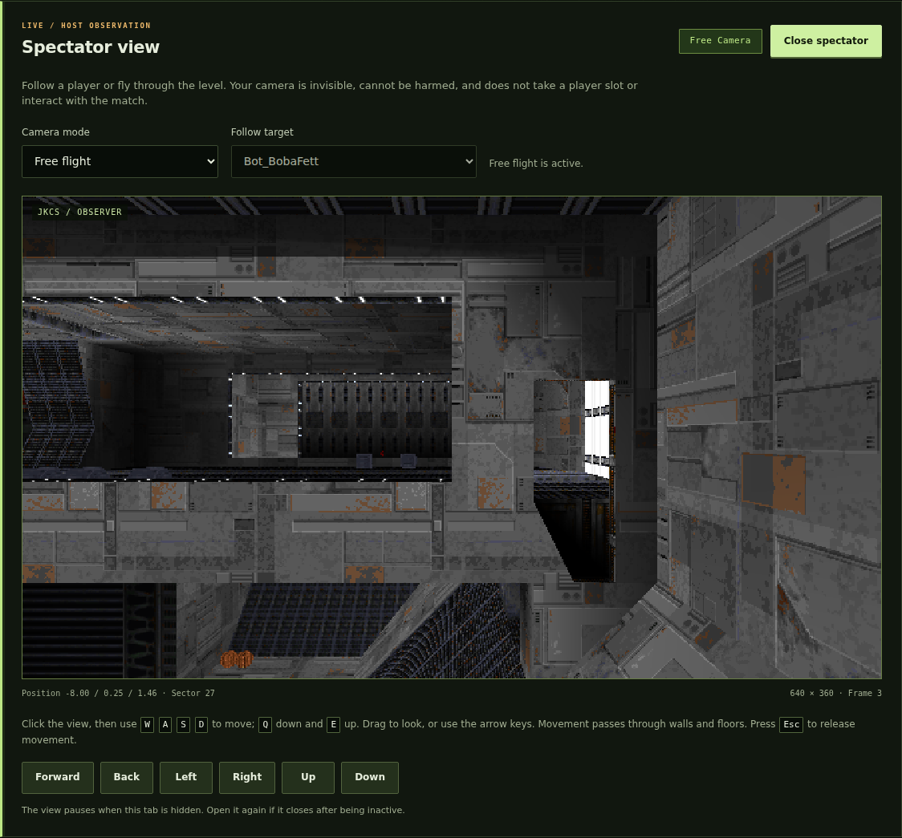

# JK Cross Server

A dedicated JKDF2 / Mysteries of the Sith host with a small browser control panel and server-side adapters for original DirectPlay, native OpenJKDF2, and the published JKDF2Web client.

**Development build. Read `docs/QUALIFICATION.md` for the exact clients and checks completed.** An actual OpenJKDF2 game simulation drives the session. Clients do not install an engine patch. JK and MotS are distinct session modes.

## What is included

- Python administration: start/stop, saved settings, stock/custom episode catalog, map selection, limits, log output, file preflight and isolated run directories.
- Persistent admin credentials for ordinary player chat commands, with explicit key issuance/revocation, an offline proof helper, and server-executed kick/next-level actions. See [Chat administration](docs/CHAT_ADMIN.md).
- GitLab release checks on startup and every six hours, verified package installation, optional automatic installation between sessions, and rollback recovery.
- A compiled Linux x86-64 dedicated engine, built from the pinned OpenJKDF2-MotS-Fixes source with server-side transport changes.
- A compiled Windows 32-bit DirectPlay bridge and its C source. On Linux it runs through Wine with a compatible original DirectPlay runtime.
- A Python WebSocket/WebRTC gateway with custom episode and active-mod downloads, plus a hash-verifying fetcher for the unchanged published browser client.
- Source patches, build instructions, tests, and qualification receipts.

Commercial game archives, retail executables, DirectPlay DLLs, and ISOs are not included. Point the server at your installed game data. Browser players select their own game data through the existing client.

## Downloads for Windows, Linux and macOS

The [0.4.0-dev release](https://github.com/CodaLilitari/jk-cross-server/releases/tag/v0.4.0-dev)
is also available on [GitLab](https://gitlab.com/codalilitari/jk-cross-server/-/releases/v0.4.0-dev).
All downloads include the bots, chat administration and spectator features on main.

| Host | Package | Runtime |
| --- | --- | --- |
| Windows | `JK_Cross_Server_0.4.0-dev-windows-docker.zip` | Docker Desktop running Linux containers |
| macOS | `JK_Cross_Server_0.4.0-dev-macos-docker.zip` | Docker Desktop; Apple Silicon uses amd64 emulation |
| Linux x86-64 | `JK_Cross_Server_0.4.0-dev-linux-x86_64.zip` | Native Ubuntu 24.04-compatible runtime, or Docker |

See [platform setup and launch commands](docs/PLATFORMS.md). Windows and Mac
packages are Linux-backed launchers, not native engine ports. The existing
`JK_Cross_Server_0.4.0-dev.zip` remains the updater-compatible package.

## Start on Linux

Use Python 3.11 or newer. The tested build environment and exact dependency pins are recorded under `native/` and `web_gateway/`.

```bash
python3 -m venv .venv
. .venv/bin/activate
python -m pip install -r web_gateway/requirements-lock.txt
python -m web_gateway.fetch_client --destination runtime/browser-client
python app.py
```

Open **http://127.0.0.1:8765**. Set the engine path to the included `bin/linux-x86_64/openjkdf2`, the game-data directory to your install containing `resource` and `episode`, and the browser build folder to `runtime/browser-client`. Read the episode catalog, select a map, save, then start.

The native engine can start without an X server using SDL's offscreen driver and Mesa/EGL. **Engine display** in Advanced settings defaults to **Auto**: it respects an existing display or explicit SDL video driver, and otherwise selects offscreen rendering. Choose **Offscreen**, **Xvfb**, or **Existing display** to select a backend explicitly. A working OpenGL/EGL implementation is still required; sound uses null/dummy drivers. Player bots and the retail Wine adapter have separate display requirements. Install Xvfb and xauth for those components on a host without a display. The panel distinguishes engine IPC connection, actual session readiness and the selected backend.

For stock JK use episode `JK1MP` and map `m2.jkl`. For stock MotS use `JKM_MP` and `mdm02_freezer.jkl`, with the MotS resource archives installed. The original data directory is not used for generated profiles or configuration. The supervisor stages data with normalized filename case and saves each run's settings and logs separately.

MotS personality sessions use advertised rank 7, which permits the tested unchanged native client to select its normal character. The panel and MotS example select this automatically. Lower ranks require ranked-Jedi mode (game flag 4096).

Optional CLI:

```bash
python app.py --config instance.json --check
python app.py --config instance.json --start
python app.py --config another-instance.json --state-dir another-state --port 8766
```

For multiple instances, assign distinct native, IPC, broker, browser, and administration ports. Retail DirectPlay also has its own legacy transport port constraints; do not assume changing the native UDP port relocates DirectPlay.

## Keep the server updated

The **Server updates** panel checks this project's published GitLab releases on
startup and every six hours. Choose **Install update** while the server is
stopped, or enable **Install automatically when the server is stopped**.
Automatic installation is opt-in and never interrupts a match. It verifies the
release, preserves local settings and game data, retains a backup, and restarts
the panel with the game still stopped.

Existing 0.2 installations need the 0.3 ZIP installed manually once. Git
checkouts use Git rather than the in-place installer. See [update instructions](docs/UPDATES.md)
for migration, recovery, multi-instance behavior, and publishing new releases.

## Host spectator view

Open **Spectator view** in the existing control panel to follow a joined player or fly an invisible camera through walls and floors. It does not take a player slot, interact with the game, or change client checksums. Closing the view keeps the match running. The Linux implementation provides a 640 × 360 view at up to five frames per second; see [controls, setup and compatibility limits](docs/SPECTATOR.md).

**Image view** remains the default. The optional **Experimental geometry (WebGL 2)** view draws the observer's validated triangle stream in the browser. It shares the same camera and player roster. This first geometry profile uses vertex colours, with no textures and approximate transparency/effects; the server still prepares and renders the native scene. See [browser geometry setup and qualification](docs/BROWSER_SPECTATOR.md).



## Optional player bots

The Linux server panel can start one to four ordinary player bots, chosen from
eight stock multiplayer identities with occasional original character chat.
Each bot runs a separate native client and uses the stock movement, weapons,
inventory, Force powers, damage, scoring and respawn rules. Retail, OpenJKDF2
and JKWeb human clients keep their existing executables and connection routes.

The panel's **Sabers only**, **Fists = peace**, and **Use Force powers** checkboxes
can be applied during a match without restarting it. Bots seek useful pickups,
choose weapons according to ammunition and range, and pursue stock CTF
objectives. Supported content is stock **JK1MP and JK1CTF, ranks 0–8**; the
implementation remains experimental. MotS bots, passwords and mods are outside
this version's scope.

The server also preserves all authored spawn points independently of the
configured player limit. This is required by stock CTF's lobby and team spawn
masks and applies to every connection route. Normal admission still enforces
the configured limit. See [the bot guide](bots/README.md) and
[behavior, build evidence and limitations](docs/BOTS_BEHAVIOR.md). The
[earlier recovery qualification](docs/BOTS_PROTOTYPE.md) is retained with its
original executable hashes.

```bash
python3 -m bots.run --list-profiles
python3 -m bots.run --server-config config/server.json --profiles boba_fett,jan_ors
```

## Client connection routes

| Client | How it connects |
|---|---|
| Original JK / MotS | Its ordinary TCP/IP DirectPlay multiplayer UI, to the server host |
| Native OpenJKDF2 | Its ordinary network UI, to the native host and UDP port |
| JKDF2Web | This server's browser origin, serving the byte-identical published client and `/relay` |

The existing public JKDF2Web website points to its own lobby. This package serves an unchanged copy of that client at your own origin; it does not insert your server into somebody else's public lobby. See `web_gateway/README.md` for exact pins, the WebRTC route, fallback behavior, and custom-content limits.

## Browser content downloads

**Send missing custom maps and mods to browser players** is enabled by default in the panel (`web_asset_downloads: true`). Select the custom episode on the host as usual. If the server uses a mod, select its folder in **Mod folder**. On startup, the server prepares the selected episode and mod for the published client's existing transfer protocol. The **Browser downloads** panel shows the offered content, fingerprints, transfer sizes, and activity.

A browser player picks their original game data and joins through the normal multiplayer UI. The unchanged client checks the host's episode, downloads a missing or different custom archive, verifies its SHA-256, and installs it. If the selected mod differs, its existing flow downloads the mod and restarts into it. Follow the client's prompt to return to Multiplayer and rejoin the session after that restart; a missing episode is downloaded during the rejoin. The client caches downloaded content using its existing browser storage.

The server uses the upstream retail-reference scheme: byte-identical original content is represented by hashes and byte ranges that the browser reconstructs from the player's own game data. Original episodes and the MotS Remastered pack are not downloads. The Remastered pack, when active in a supported location, must already be available on the client with the matching fingerprint.

Custom assets belong in the selected episode archive or configured mod folder. Unadvertised resource overrides are rejected when preparing browser content so the server does not advertise an incomplete mod. Retail and native clients continue to install matching custom content themselves.

Disabling downloads prevents asset chunks from being sent. The server still advertises the selected mod and supplies custom-map fingerprint metadata so a browser with matching local content can join. A browser genuinely missing the custom map follows its existing download timeout. See `web_gateway/README.md` for transfer limits and exact behavior.

## Enable retail

Set the DirectPlay bridge path, enable the retail adapter, and on Linux set a Wine executable/launcher and a dedicated Wine prefix. That prefix needs a working original DirectPlay TCP/IP provider. The bridge itself contains no original game or Microsoft binaries. See `directplay/README.md` for tested runtime setup and precise provenance.

Mixed sessions reserve DirectPlay identities for native/browser participants. The engine uses those real identities, so an ordinary retail peer can address them. Mixed mode supports up to 15 playing clients, shared by humans and bots. The engine adds the dedicated host separately. Stock maps may impose a lower practical spawn limit. The retail session browser also counts reserved transport identities. The administration panel's joined-player count excludes these reservations.

## Network configuration

Defaults keep administration and the browser gateway on loopback. Native GNS uses UDP 3500 by default. DirectPlay uses the original TCP/IP provider's discovery and session sockets. For an Internet host, configure the appropriate routing/firewall and browser TLS/WebSocket reverse proxy deliberately. Do not expose the administration port as a game endpoint.

See `docs/NETWORKING.md` for the endpoint table, LAN connection steps, remote administration, browser profile setup, and STUN/TURN configuration.

The browser has reliable ordered WebRTC channels and its existing WebSocket fallback. The unchanged client limits some movement updates to 200 ms when using fallback. No public STUN/TURN service is contacted by default. The native IPC and adapter broker are authenticated loopback services, not client endpoints.

Optional STUN/TURN configuration is available in the advanced panel as `web_ice_servers`. For example, a TURN entry has `urls`, `username`, and `credential` fields. Keep the array empty for direct connections. Internet NAT traversal is a separate deployment check from the local compatibility tests.

## Content and compatibility

Use the same episode and mod resources on all participants. Browser downloads establish matching custom content through the published client's existing checks. Archive hashes establish content identity; gameplay parity still depends on the participating engine versions and the mod itself. The qualification report separates stock multiplayer interoperability from missing-content download checks.

MotS has a known legacy native-client sector-field mismatch. The server adapts that field at the native edge while preserving retail/browser format. See `native/README.md` for the tested native reader and the explicit corrected-reader option. This is a server setting, not a patch installed on clients.

## Source and credit

Project direction: Andrei. Implementation and integration: Lilitari, with parallel native-engine, browser-transport, and retail-runtime collaborators. Based on work by the OpenJKDF2 contributors, Coda Lilitari's MotS-fixes fork, and Tristamus's JKDF2Web client and lobby protocol. Original game, community, and dependency authors retain their credits and licenses. See `NOTICE.md` and `licenses/`.
