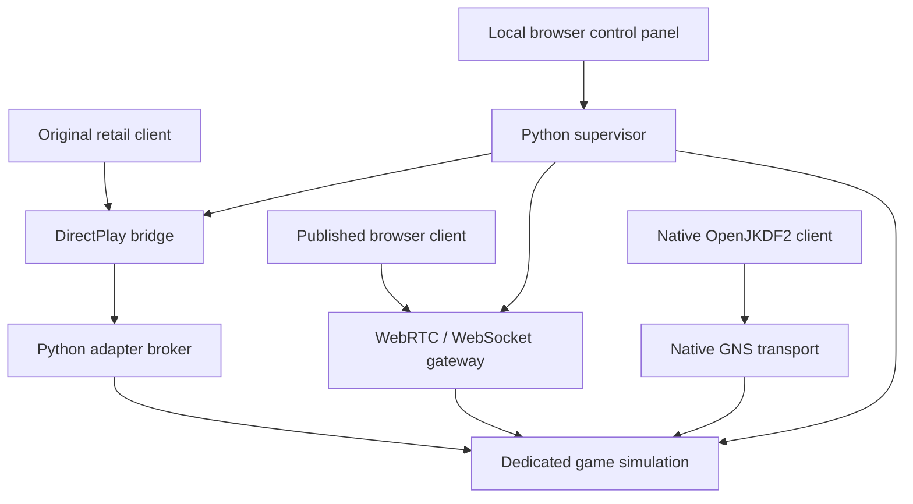

# How the cross-client server works

## One game simulation, three existing transports

The server runs a real OpenJKDF2 dedicated game simulation. Original retail JK/MotS, native OpenJKDF2, and the published browser client reach that simulation through the network APIs they already implement. Every compatibility change in this package is on the host. Client game executables and the published browser HTML, JavaScript, and WebAssembly are unchanged.

The native transport remains Valve GameNetworkingSockets. A new authenticated loopback IPC connection gives the Python supervisor session metadata and permits external peers to join the same simulation. The DirectPlay bridge and browser gateway deliver ordinary Sith game messages through this connection. The wire framing and engine entry points are specified in `native/protocol.md`.

The browser gateway implements the existing client's relay protocol. It advertises a real engine-backed room, negotiates the client's reliable ordered WebRTC channels, and supports its existing WebSocket fallback. The public JKDF2Web deployment points to its own lobby; this package serves byte-identical published assets at the operator's origin so their existing same-origin `/relay` path reaches this server. No replacement WASM or patched client bundle is required.

## Browser episode and mod delivery

The host also implements the published browser's `JKMT` map-transfer protocol. Its control frames are recognized at the browser boundary and never forwarded into the game simulation. The selected episode and optional active mod are prepared before the engine starts, so remote requests identify prepared offers rather than filesystem paths.

The browser receives file metadata, a SHA-256 fingerprint, and a chunked transfer stream over its existing `jk-map` WebRTC channel or WebSocket fallback. The stream contains a table of original-content references plus the remaining custom bytes. The client rebuilds referenced ranges from its own original game archives, validates the complete file hash, and then installs the episode or mod using its existing code. The original retail archives remain local prerequisites.

An active mod is packed deterministically using the upstream file ordering and GOB layout. Its fingerprint and name are advertised in a `JKMD` tail appended at the browser welcome/session edge. The native engine and DirectPlay adapter continue to receive the original 240-byte descriptor. This tail lets the browser use a matching local or cached mod, or obtain and restart into the host's mod. A recognized active MotS Remastered pack is advertised by fingerprint but is never sent.

Each offer is a snapshot tied to the running session. The transfer path validates headers, destination, kind, content identifier, and bounded chunk windows; it applies backpressure separately from gameplay delivery and cancels work when a peer leaves. The administration API exposes content summaries and transfer counters. Disabling downloads retains metadata needed for matching local content while suppressing file chunks.

## Why the DirectPlay bridge reserves identities

Original retail clients send game messages to DirectPlay player IDs. Giving a browser player an arbitrary number in the game roster is insufficient: the original DirectPlay runtime must also know that player object before the retail client can address it.

The bridge therefore creates real local DirectPlay player objects as transport surrogates. It passes their IDs to the simulation before native or browser connections are admitted. Native and browser peers receive those same IDs as their canonical network identities. Original retail peers keep the IDs assigned by their own DirectPlay connections. Most packets then travel without rewriting embedded player identities.

The actual DirectPlay 5 runtime rejected additional local player objects in a `DPSESSION_CLIENTSERVER` session. The bridge uses the original peer-session layout instead. It translates the host's special canonical ID, 1, to the host's real DirectPlay ID at the retail boundary. Only the source-audited host-ID fields in management messages are translated; arbitrary payload bytes, object GUIDs, and script arguments are not searched and replaced.

This arrangement reserves physical DirectPlay slots before all human players arrive. A mixed session therefore has a maximum of 15 configured human seats, and the original retail session browser includes reserved transport objects in its displayed player count. The administration panel separately reports the simulation's fully joined human players. Native/browser sessions with the retail adapter disabled do not need Wine or a DirectPlay ID pool.

## Dedicated-host and join differences

Several differences are visible only after a real client begins synchronization:

* Native and browser client transports enumerate a synthetic small player-ID list. Their join gate would otherwise wait for a real external DirectPlay ID to appear in that synthetic list. The server sends their enumeration gate a host-only response while retaining full canonical identities in the actual game roster and state.
* The original retail client only broadcasts to roster entries marked active. OpenJKDF2's dedicated host clears that bit and relies on an OpenJKDF2 client special case for host slot zero. The DirectPlay adapter marks the host as a network recipient in retail-bound roster messages while leaving its spawn bit clear and preserving its disabled world object. A loaded map alone does not prove this handshake finished; qualification requires the final welcome and continuing game traffic.
* The pinned native MotS client sends a 32-bit sector in absolute CreateThing messages but reads 16 bits. The server uses the retail/browser 32-bit representation internally and converts only that native outbound field. A server environment setting supports native clients with a corrected reader. The transport does not identify a client's source revision, so the two native reader profiles cannot be detected automatically on one endpoint.

The server also fixes an existing UpdateState light-field serialization mismatch. These changes are deliberately narrow and documented in the source patch. They do not establish that every mod, force-power interaction, or later client release has been qualified.

The retail edge reorders the original JK roster's team-first statistics and
changes only the team field's width (original U8 versus native S16). Kills,
deaths, suicides and score remain signed 16-bit values. The existing MotS
roster conversion is retained pending separate verification of its field
semantics. The adapter also translates three power-up flag widths (original
S16 versus native U32) and MotS's chat recipient-list prefix. Original recipient
scope and reliable-message sequence are preserved. The converter validates
complete layouts and capacity before committing changes; the corrected JK
field evidence is in `qa/retail-jk-score-layout-audit.json`.

For JK, an eligible failed DirectPlay send may discard an obsolete frame only
after fresh queries confirm an owned/local/present sender, a complete bounded
player enumeration, and an absent destination. Broadcast disposal requires zero
nonlocal players. Other errors remain fatal; packets are not retried. This
policy does not change MotS handling. The final adapter passed ordinary retail
leave/rejoin continuity, but that run did not exercise the failed-send branch;
see `qa/retail-jk-departure-regression.json` and the deterministic policy tests.

## Administration and lifecycle

The Python service provides a small local browser panel for selecting JK or MotS, choosing the game-data folder, listing multiplayer episodes/maps, setting session limits, starting/stopping, and inspecting status and logs. JK and MotS are separate session modes with separate content; a base-JK executable is not expected to enter a MotS match.

Before startup, the supervisor validates configuration and the selected archive. It stages a separate run tree, normalizes filename case for the Linux engine, and keeps generated registry/profile/log files out of the installed game directory. Archives are hard-linked when possible and copied otherwise. Each run records its settings, episode hash, and logs.

The engine still needs an initial X/OpenGL context during headless startup. On a Linux host without `DISPLAY`, the supervisor launches it through Xvfb. Audio uses dummy/null drivers. The desktop game UI is not the server control interface.

Startup waits for the actual engine IPC handshake, checks the game mode, starts the broker, and waits for the DirectPlay identity pool before opening the browser room. A component exit stops the whole session. Optional automatic restart is bounded. Shutdown closes active browser and adapter connections before waiting for their servers, then terminates owned child processes.

The administration listener binds to loopback, checks its host/origin, and requires a per-process token on its API. Game-facing ports are separate. Native IPC and the adapter broker bind to loopback and use a fresh token for each session. Incoming network source IDs are bound to the transport connection that owns them. These controls support normal operation; this project does not claim a security audit of the original game engines or legacy DirectPlay runtime.

## Scope of the evidence

Unit and integration tests cover framing, routing, ownership, session metadata, mode separation, WebRTC/WebSocket transport, and lifecycle behavior. Actual client qualification is recorded separately in `QUALIFICATION.md`, with exact source and binary hashes where available. Synthetic peers, a successful lobby listing, a rendered map, a completed join, and sustained shared gameplay are distinct milestones. The report uses those distinctions rather than treating one as proof of another.

Custom browser episode and active-mod downloads have their own qualification records. They do not establish gameplay compatibility for arbitrary mods. Participants still need matching original game data. Internet NAT traversal, public deployment, all client releases, long-session stability, and all JK/MotS game features require their own qualification before broader support claims.
