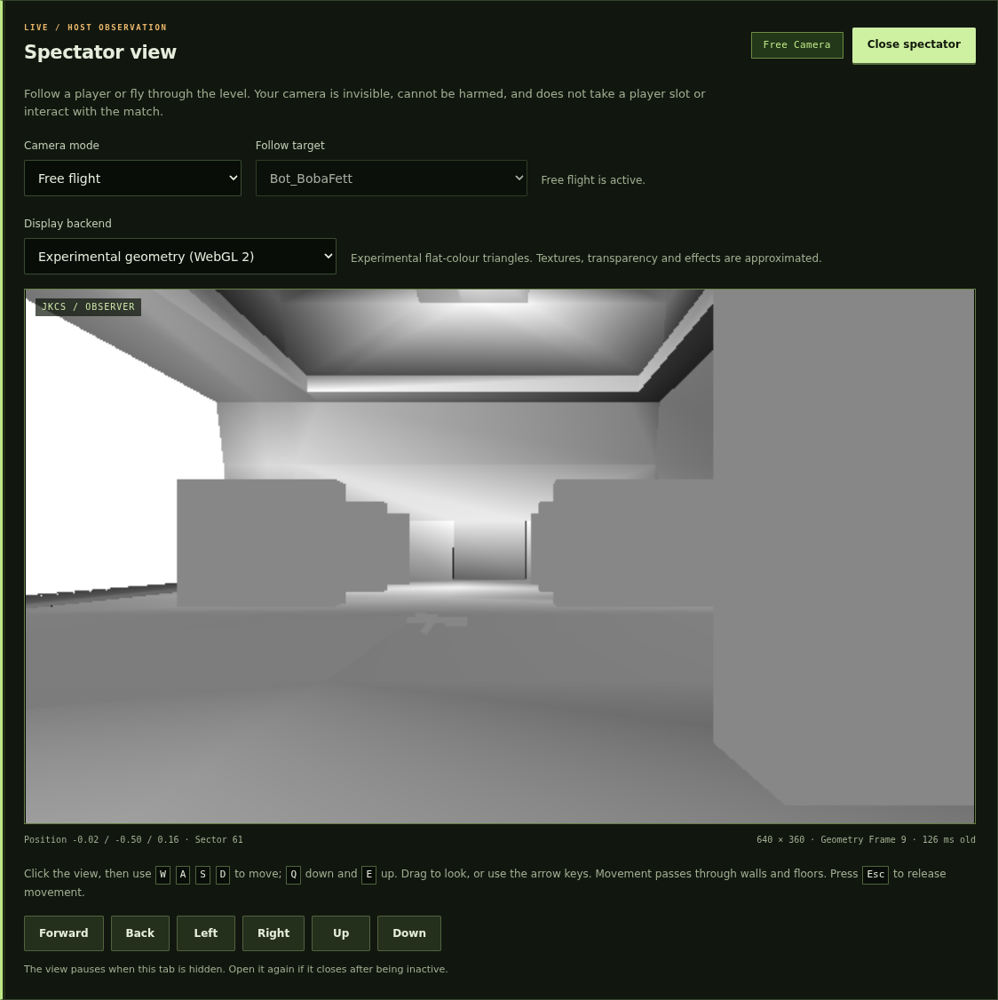

# Experimental browser geometry spectator

The host spectator now has two display choices for the same independent camera.
**Image view** remains the default. **Experimental geometry (WebGL 2)** receives
validated clip-space triangles and rasterizes them in the browser. Free flight,
player following, camera ownership and the no-player-slot design are shared.

## Use it

1. Start a session with **Prepare spectator graphics when the server starts**
   enabled. If you change this setting, restart the session.
2. Open **Spectator view** in the existing local control panel.
3. Choose **Experimental geometry (WebGL 2)** under **Display backend**.
4. Use the normal free-flight controls or choose a joined player to follow.
   Switch back to **Image view** at any time.

A display switch releases held movement and retains the same camera. A browser
without WebGL 2, a lost context or a geometry transport failure returns to the
image view with a diagnostic. An older image-only engine can still supply its
image view. Closing the spectator leaves the game running. Five seconds without
authenticated frame requests expires the viewer lease; reopen the view to resume.

## What the browser renders

The native observer still performs world visibility, camera transforms,
projection and lighting. Its existing read-only render scope also collects the
indexed triangle batches. The separate JKSG stream carries clip-space XYZW,
opaque RGBA8 vertex colours and uint32 indices. The browser validates the complete
frame before uploading it and issues WebGL 2 indexed triangle draws with depth
testing. It does not receive the retail archives, textures, COG scripts, engine
memory, executable commands or arbitrary GPU instructions through this channel.

This is a first flat-colour profile. It has no textures; sky, transparency,
special depth/culling rules and effects can differ from the image view. Native
RGBA capture and the hidden graphics context still run. This milestone does not
claim graphics-free server startup, full visual parity or a performance gain.

| Property | Image view | Experimental geometry |
| --- | --- | --- |
| Rasterization | Native OpenGL; browser displays RGBA | Browser WebGL 2 draws native-prepared triangles |
| Appearance | Existing native textured scene | Opaque vertex colours; approximations above |
| Camera and roster | Independent host observer | Same observer and control epochs |
| Transport | Existing private JKSV channel | Independent private JKSG channel |
| Browser requirement | 2D canvas | WebGL 2; image fallback |
| Native graphics context | Required while prepared | Still required |
| Default | Yes | Explicit opt-in |

## Bounds and lifetime

The current profile is limited to 640 × 360, up to five captures per second,
65,536 vertices, 196,608 indices and 2,097,152 payload bytes. Each channel has at
most one pending native envelope. Backpressure skips a new geometry capture;
a partly transmitted envelope finishes or its own channel closes. Geometry
faults do not close the image or game-control channel.

Operation 3 renews a separate five-second geometry lease at most once per second
through authenticated geometry requests. Status and camera input do not renew
that geometry lease. World/control epochs, current session state, sequence and a
2,000 ms maximum capture age reject obsolete data. The browser also accounts for
fetch time and rejects delayed results after display, session or epoch changes.
Malformed or oversized native captures have bounded diagnostic logging.

See [the exact JKSG v1 contract](SPECTATOR_GEOMETRY_PROTOCOL.md) for every field,
limit and coordinate conversion. The [existing spectator guide](SPECTATOR.md)
explains movement and setup; [native build provenance](../qa/browser-spectator-native-build.json)
and [packaging verification](../qa/browser-spectator-native-packaging.json) identify
the executable and its link materials.

## Qualification and limits

The evidence folder `qa/browser-spectator/` records the actual test results,
source hashes, screenshots and scoped reviews. The synthetic renderer fixture
uses original numeric geometry and checks eight real WebGL pixels for colour,
depth order, winding, perspective division and clear colour. Live qualification
uses stock JK1MP/m2 and two ordinary packaged bot clients. It exercises display
switching, camera movement, following, mobile layout, fallback and observer
closure while checking the roster remains two players.

The live browser was Chromium with SwiftShader WebGL 2. This is real shader
execution and rasterization, but does not certify every browser or hardware GPU.
Live geometry qualification does not repeat the older retail/JKWeb crossplay,
MotS, mod, map-transition or long-duration gameplay tests. Historical receipts
retain their original hashes and scope. Performance, sustained congested live
play and texture/effect parity remain outside this milestone.

The delivered native package targets Linux x86_64. Review identified that the
new typed geometry hook needs a conditional declaration for the existing
`RDCACHE_RENDER_NGONS` / `TARGET_TWL` build profile. That alternate profile is
not qualified by this branch; its follow-up is recorded in the review evidence.
